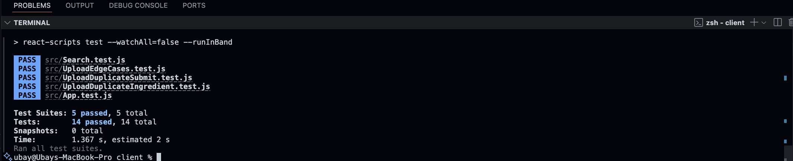
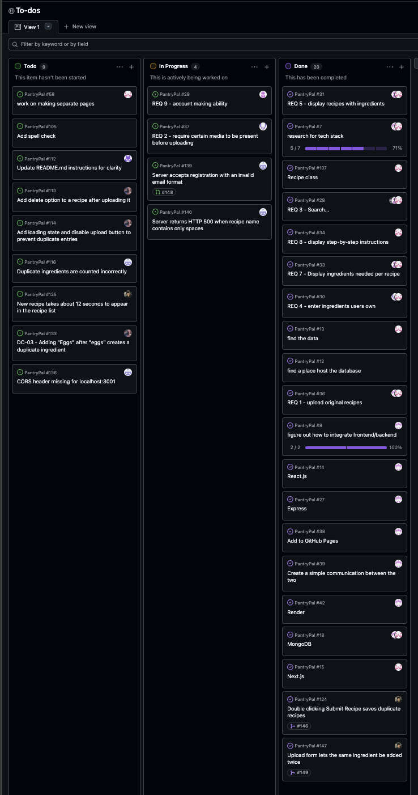

# PR4 Team Report

**Team Number:** 12

**Team Members:** Rory Campbell, Gabe Elias, Deandre Chandler

---

## 1. Bug Triage Table

| Test name | Bucket | Issue link | Severity | Priority | Owner | Status |
|---|---|---|---|---|---|---|
| Search with one spelling error: `tomato sause` should match `tomato sauce` | Code bug | [Issue #128](https://github.com/AkshayaPathipati/PantryPal/issues/128) | Medium | High | Rory Campbell | Fixed |
| Delete a submitted recipe after confirmation | Missing feature | [Issue #145](https://github.com/AkshayaPathipati/PantryPal/issues/145) | Medium | Medium | Rory Campbell | Fixed |
| `App.test.js` expects the old “Learn React” link | Test bug | [Issue #150](https://github.com/AkshayaPathipati/PantryPal/issues/150) | Low | Low | Rory Campbell | Fixed |

### Triage Notes

The spelling-error search test was classified as a code bug because the test correctly represented the requirement, but the original search code only used exact ingredient matching. The search logic was updated to allow a one-character spelling difference.

Recipe deletion was classified as a missing feature because the original application did not include a Delete Recipe button or a backend delete endpoint. The feature was implemented with a confirmation dialog, frontend DELETE request, backend delete route, and refreshed recipe list.

The original `App.test.js` was classified as a test bug because it expected the default Create React App “Learn React” link. PantryPal no longer contains that link, so the test was updated to check for the PantryPal heading.

---

## 2. Regression Log

### Regression Results

**No regressions found.**

The full test suite was run on:

- 11/17/2026
- 11/22/2026

The command used was:

```bash
cd client
npm test -- --watchAll=false --runInBand
```

Final regression result:

```text
Test Suites: 2 passed, 2 total
Tests:       7 passed, 7 total
```

No old tests broke after the spelling-search fix, recipe-deletion work, or App test correction.

---

## 3. Final Test Run



The final full test suite was run from the `client` directory using:

```bash
npm test -- --watchAll=false --runInBand
```

### Final Results

```text
Test Suites: 2 passed, 2 total
Tests:       7 passed, 7 total
```

### Remaining Failing Tests

No frontend tests remain failing in the final test run.

Backend integration testing was not completed because the team did not have the required MongoDB connection information or access to the Render deployment.

---

## 4. Feature Decision

**Chosen feature:** Recipe deletion

**Feature Issue:** [Issue #145](https://github.com/AkshayaPathipati/PantryPal/issues/145)

### User Story

As a PantryPal user, I want to delete a submitted recipe, so that I can remove recipes that are outdated or were added by mistake.

### Why We Chose This Feature

The team chose recipe deletion because users could submit and view recipes but had no way to remove them. This was identified as a missing feature during testing. It also improves basic recipe management and can be verified with frontend and backend tests.

### Ownership

- **Frontend:** Rory Campbell
- **Backend/database:** Rory Campbell
- **Testing:** Team
- **Documentation:** Team
- **Code review:** Team

### Acceptance Test Cases

1. **Delete a recipe after confirmation**

   - Load or submit a recipe named `Limeade`.
   - Show the submitted recipes.
   - Click the `Delete Recipe` button.
   - Confirm the deletion.
   - Verify that a DELETE request is sent for the selected recipe.
   - Verify that the recipe no longer appears after the recipe list refreshes.

2. **Canceling deletion keeps the recipe**

   - Load or submit a recipe named `Limeade`.
   - Show the submitted recipes.
   - Click the `Delete Recipe` button.
   - Cancel the confirmation dialog.
   - Verify that no DELETE request is sent.
   - Verify that the recipe remains visible.

---

## 5. Board Snapshot



---

## 6. Sprint Summary

