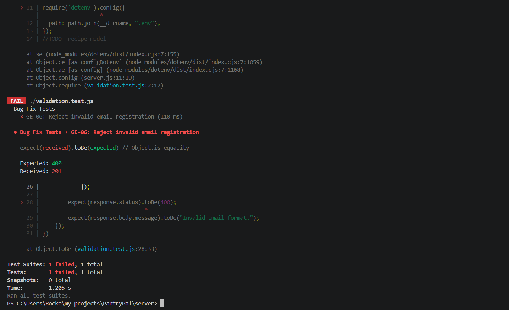
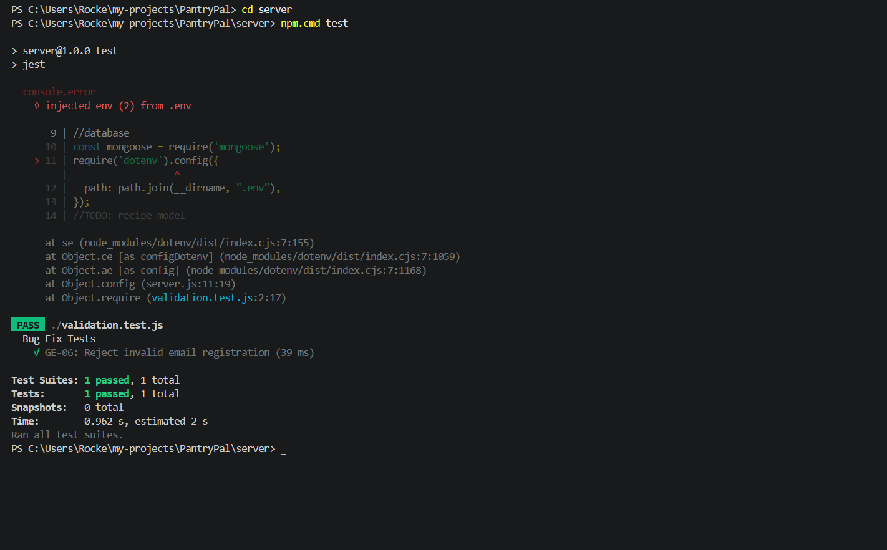
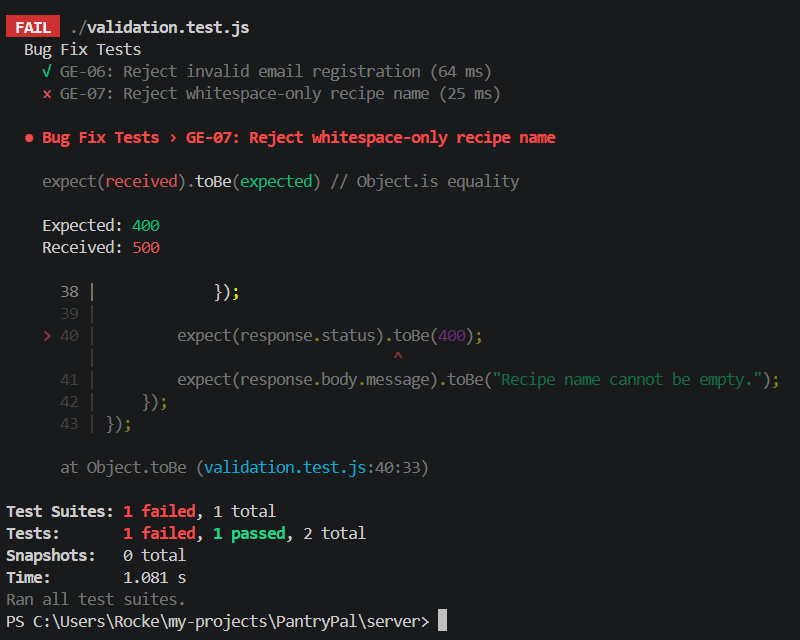
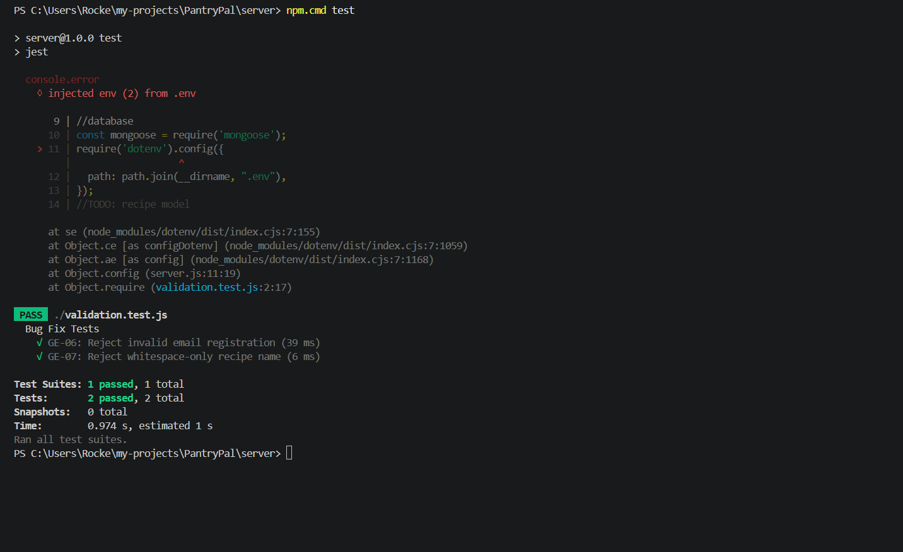

# Gabriel 

## PR4 Individual Report

**Name:** Gabriel Elias  
**Team:** Group 12  
**Area:** Server & API Configuration 

---

## Fix 1: Server Accepts Registration with an Invalid Email Format

- **Issue:** [Issue #139](https://github.com/AkshayaPathipati/PantryPal/issues/139)
- **Pull Request:** https://github.com/AkshayaPathipati/PantryPal/pull/148
- **Before screenshot:** `screenshots/gabriel_elias_issue139_before.png`
- **After screenshot:** `screenshots/gabriel_elias_issue139_after.png`
- **Classification:** Code bug
- **Severity:** Medium
- **Priority:** Medium 

### Description

The server accepted registration containing an invalid email format instead of rejecting them. Users could attempt to register with an incorrectly formatted email address, and the server wasn't checking if the email was valid before allowing the user to register. 

**Classification:** Code bug.

**Reason:** This was classified as a code bug because the test correctly expected invalid email formats to be rejected, but the server accpeted the invalid input. 

### Fix

The registration code was fixed to check whether the email format is valid before creating an account. Invalid emails are now rejected with a HTTP 400 Bad Request error instead of being accepted by the server. 

---

## Fix 2: Server returns HTTP 500 when recipe name contains only spaces

- **Issue:** [Issue #140](https://github.com/AkshayaPathipati/PantryPal/issues/140)
- **Pull Request:** https://github.com/AkshayaPathipati/PantryPal/pull/157
- **Before screenshot:** `screenshots/gabriel_elias_issue140_before.png`
- **After screenshot:** `screenshots/gabriel_elias_issue140_before.png`
- **Classification:** Code bug
- **Severity:** Medium
- **Priority:** Medium

### Description

The server returned an HTTP 500 error when a user submitted a recipe with a name containing only spaces. Instead of properly rejecting the invalid input, the request caused a server error. 

**Classification:** Code bug

**Reason:**

This was classified as a code bug because the test correctly expected the server to reject a whitespace-only recipe name without crashing. 

### Fix

The recipe validation was fixed to check whether the name contains actual text before saving it. Recipe names containing only spaces are now rejected with a HTTP 400 Bad Request error instead of causing a server error. 

---

## AI Disclosure

ChatGPT was used to help understand the bugs, assist with writing and debugging tests, improve grammar and wording, and format this report. 