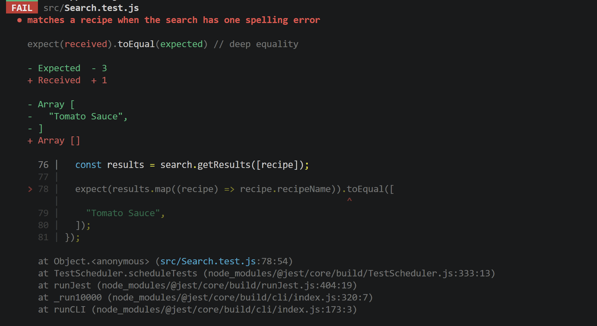
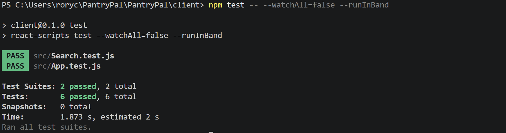
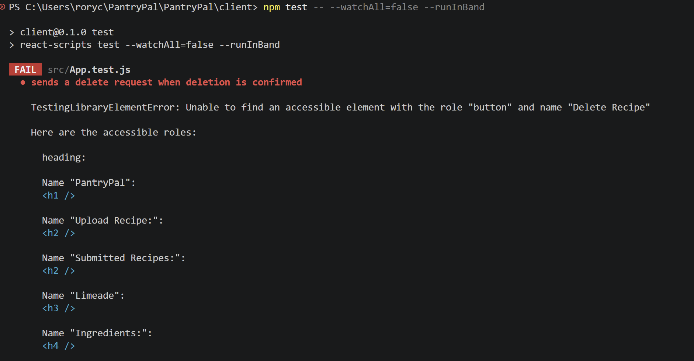
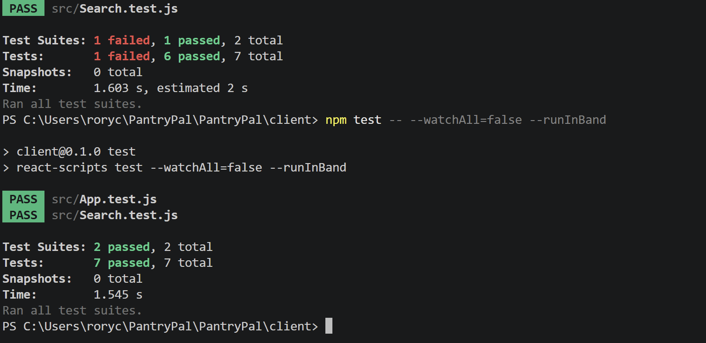

# Gabriel 

## PR4 Individual Report

**Name:** Gabriel Elias  
**Team:** Group 12  
**Area:** Server & API Configuration 

---

## Fix 1: Server Accepts Registration with an Invalid Email Format

- **Issue:** [Issue #139](https://github.com/AkshayaPathipati/PantryPal/issues/139)
- **Pull Request:** https://github.com/AkshayaPathipati/PantryPal/pull/148
- **Before screenshot:** `screenshots/gabriel_elias_issue139_before.png`
- **After screenshot:** `screenshots/gabriel_elias_issue139_after.png`
- **Classification:** Code bug
- **Severity:** Medium
- **Priority:** High

### Description

The recipe search did not return a recipe when the user made one spelling mistake in an ingredient. For example, searching for `tomato sause` did not find a recipe containing `tomato sauce`.

The test was correct because the requirement expected the application to tolerate a one-character spelling mistake. The code was wrong because it only used exact ingredient matching.

### Fix

The search logic was updated to allow a recipe ingredient to match when the search term is within one character of the correct spelling. Exact matches continue to work normally.

---

## Fix 2: Recipe Deletion

- **Issue:** [Issue #145](https://github.com/AkshayaPathipati/PantryPal/issues/145)
- **Pull Request:** https://github.com/AkshayaPathipati/PantryPal/pull/152
- **Before screenshot:** `screenshots/rory_campbell_issue145_before.png`
- **After screenshot:** `screenshots/rory_campbell_issue145_after.png`
- **Classification:** Missing feature
- **Severity:** Medium
- **Priority:** Medium

### Description

Users could submit and view recipes, but they could not delete a submitted recipe. The application did not have a Delete Recipe button or a backend delete route.

This was classified as a missing feature because recipe deletion was not implemented in the original application. A test was added to verify that a recipe can be deleted after the user confirms the action.

### Fix

A Delete Recipe button was added to each submitted recipe card. When the user clicks the button:

1. The application asks for confirmation.
2. A `DELETE` request is sent to `/api/recipes/:id`.
3. The backend deletes the recipe from MongoDB.
4. The submitted recipe list is refreshed.

---

## Test Bug Corrected

The original `App.test.js` expected the default Create React App text, “Learn React.” PantryPal no longer contains that link, so the test was incorrect.

## AI Disclosure

ChatGPT was used to format the this markdown file.
