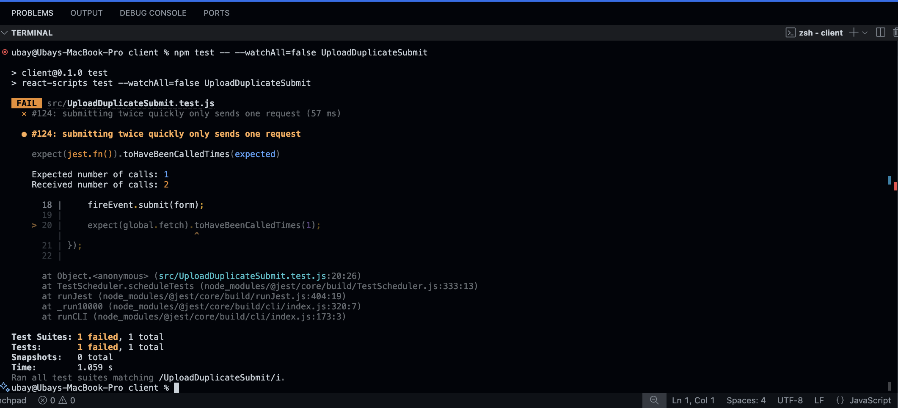
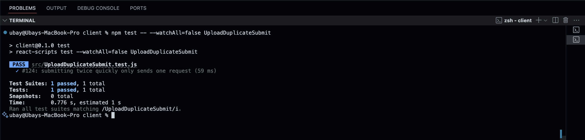
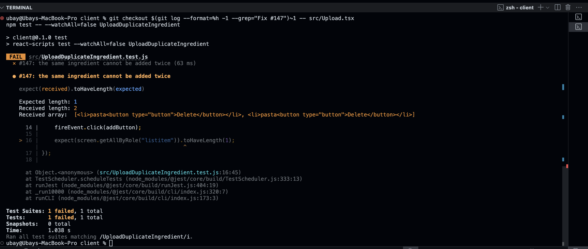
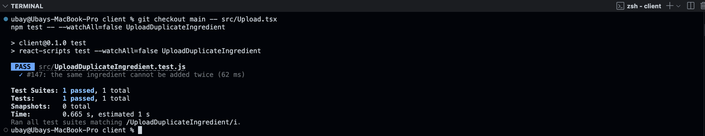

# Ubaydulla Noorullah

## Bug Fix 1: Double-clicking Submit saves duplicate recipes

- Issue: #124
- PR: #146

Before:

After:

Code bug. Test UN-03 was correct: one submit should save one recipe, but the code sent a new request on every click, which saved 4 copies on Slow 3G.

## Bug Fix 2: Upload form lets the same ingredient be added twice

- Issue: #147
- PR: #149

Before:

After:

Code bug. A recipe should never list the same ingredient twice, but addIngredient() never checked the list, and the live data already had "Tomato" saved twice in one recipe.

## AI Disclosure

I used Claude to help explain the bugs, suggest the fixes for handleSubmit() and addIngredient(). I ran every test myself and took all the screenshots.
