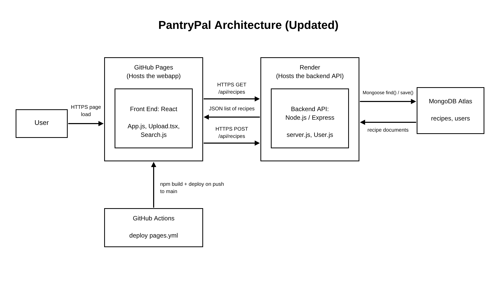

# Trace the Click: System Map

Team: Group 12
Inherited project: Group 11 (PantryPal)
Repo: https://github.com/AkshayaPathipati/PantryPal

## Team and roles

| Role | Owns | Name |
|---|---|---|
| Product Analyst | Part 1, questions in Part 4, and Part 6 | Rory Campbell |
| Architect | Part 2, the mismatches in Part 4, and Part 5 | Ubaydulla Noorullah |
| Frontend Tracer | Part 3, client side, and Part 6 | Deandre Chandler |
| Backend Tracer | Part 3, server side, and Part 5 | Gabriel Elias |

## Part 1: Purpose

This system lets users enter ingredients they have, receive recipes that use those ingredients from a database, and create new recipes with a username, ingredient list, recipe name, and instructions, that are then saved to that same database.

User action we traced: **Add a recipe to the database**

## Part 2: As-built architecture diagram

## Part 3: Trace the click

| Step | Layer | File and function | Data in / data out | Notes or surprises |
|---|---|---|---|---|
| 1 | Frontend | `client/src/Upload.tsx` → `handleSubmit()` | Submit click → new recipe | Only checks for at least 1 ingredient |
| 2 | Frontend | `client/src/Recipe.js` → `constructor()`, `toJSON()` | Form state → JSON object | |
| 3 | Frontend | `client/src/Upload.tsx` → `fetch()` | Recipe JSON → POST /api/recipes | |
| 4 | Middleware | `server/server.js` → `app.use(cors({...}))` | Frontend URLs → permission to access backend | Allows local servers and GitHub Pages to send requests to the backend |
| 5 | Middleware | `server/server.js` → `app.use(express.json())` | JSON data → `req.body` | Lets the backend read JSON data from the frontend |
| 6 | API route | `server/server.js` → `app.post('/api/recipes')` | username, recipeName → JSON response | The added ingredients are not saved in a recipe |
| 7 | Backend logic | `server/server.js` → `Recipe.create()` | `req.body` → saved recipe in database | Saves the username and recipe name in the database |
| 8 | Database | `server/server.js` → `mongoose.connect()` | MongoDB URL → database connection | Connects the Node.js backend to MongoDB |
| 9 | Response back | `client/src/App.js` → `fetchRecipes()` | GET /api/recipes → `setRecipes(data.recipes)` | Refetches the entire list after every upload |

## Part 4: Reality check and open questions

What the handoff docs got wrong or left out:

1. The handoff said Render hosts the front end, but it's actually on GitHub Pages. The original UML also left out what the arrows were sending.
2. The handoff labels the deploy box "Get Hub" and leaves out GitHub Actions and the deploy-pages.yml file completely.

Questions for the original team:

1. **Intent:** Was it intentional for the application to display a recipe picture if one exists, even though the current upload form and database setup do not include an image field?
2. **Intent:** Was it intentional that duplicate ingredients can be added to the user's ingredient list?
3. **Design:** Why does the Search class perform exact ingredient comparisons instead of supporting partial matches or alternate ingredient names?

## Part 5: Candidate requirements

| ID | Candidate requirement | Type | Source | Status | Acceptance criterion |
|---|---|---|---|---|---|
| CR-1 | The system shall allow the client to retrieve recipes when it runs on an approved local development port. | Non-functional (compatibility) | Trace row 4, `server/server.js` → `app.use(cors({...}))` allows only `http://localhost:3000`, `http://localhost:5173`, and the listed GitHub Pages origin. | Suspected bug | Running the client from `http://localhost:3001` and requesting `GET /api/recipes` succeeds without a browser CORS error. |
| CR-2 | The system shall save the recipe name submitted by a user. | Functional | Trace rows 6–7, `server/server.js` → `app.post("/api/recipes")` passes `recipeName` to `Recipe.create()`; however, the route omits required `instructions`, so the request can fail before any recipe is saved. | Suspected bug | Submitting `{ username: "Name", recipeName: "Toast", ingredients: ["bread"], instructions: "Toast the bread" }` creates a database record whose `recipeName` is `"Toast"`. |
| CR-3 | The system shall return recipes that contain at least one exact ingredient match. | Functional | `client/src/Search.js` → `getResults()` | Confirmed | With the active search tag `"eggs"`, a recipe containing `["EGGS", "pepper"]` is returned, while a recipe containing only `["avocado"]` is not returned. |
| CR-4 | The system shall return a recipe when the searched ingredient differs from a recipe ingredient by one spelling error. | Functional | Handoff Section 11, known search bug: a search such as `"tomato sause"` should find `"tomato sauce"`; no spellcheck exists in `client/src/Search.js`. | Suspected bug | Searching for `"tomato sause"` returns a recipe whose ingredient list contains `"tomato sauce"`. |
| CR-5 | The system shall save only one recipe when the same submission is sent twice. | Functional | `client/src/Upload.tsx` → `handleSubmit()` sends a request each time the form is submitted; `server/server.js` → `app.post("/api/recipes")` has no duplicate-submission check. | Suspected bug | Sending the same recipe submission twice, or double-clicking Submit Recipe, creates one database record rather than two identical records. |
| CR-6 | The system shall save the ingredients submitted with a recipe. | Functional | Trace rows 6–7, `server/server.js` → `recipeSchema` defines `ingredients`, but `app.post("/api/recipes")` destructures only `username` and `recipeName`. This conflicts with the handoff's claim that recipe uploading is complete. | Suspected bug | Submitting `{ username: "Name", recipeName: "Toast", ingredients: ["bread"], instructions: "Toast the bread" }` creates a record containing `ingredients: ["bread"]`. |
| CR-7 | The system shall store media associated with a recipe. | Functional | Planned class diagram includes `Recipe.file`, `Recipe.attachFile()`, `Upload.validateFile()`, and `Upload.uploadFile()`; the use-case diagram includes “Upload Recipe Media”; the handoff says media upload is partial and not implemented. | Unconfirmed | Given a valid image file and recipe, the saved recipe record contains a media reference. The current source has no implemented file-upload function or media field in the recipe schema. |

## Part 6: Three unit test cases

Owner: Team

| ID | Requirement | Kind | Unit under test (file and function) | Input | Expected output | Predicted result today |
|---|---|---|---|---|---|---|
| TC-1 | CR-3 | Positive | `client/src/Search.js` → `getResults()` | Create a `Search` object, call `setTagList(["eggs"])`, and pass one recipe with ingredients `["EGGS", "PEPPER", "SALT"]`. | The result contains that recipe, with `matchCount: 1` and `matchedIngredients: ["eggs"]`. | Pass |
| TC-2 | CR-3 | Negative | `client/src/Search.js` → `getResults()` | Create a `Search` object, call `setTagList(["avocado"])`, and pass one recipe with ingredients `["eggs", "pepper"]`. | The result is an empty array. | Pass |
| TC-3 | CR-4 | Boundary | `client/src/Search.js` → `getResults()` | Create a `Search` object, call `setTagList(["tomato sause"])`, and pass one recipe with ingredients `["tomato sauce"]`. | The recipe is returned because the search term is exactly one spelling error from the stored ingredient. | Fail: the current code uses exact equality and has no spellcheck. |

