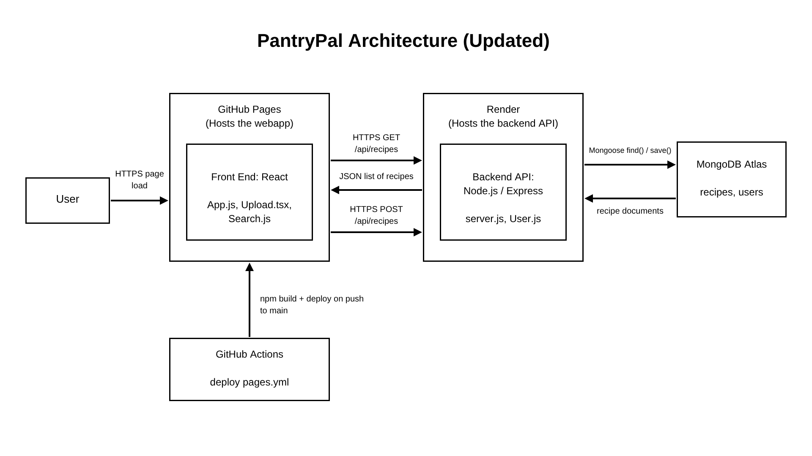

# Trace the Click: System Map

Team: Group 12
Inherited project: Group 11 (PantryPal)
Repo: https://github.com/AkshayaPathipati/PantryPal

## Team and roles

| Role | Owns | Name |
|---|---|---|
| Product Analyst | Part 1 and the questions in Part 4 | Rory Campbell |
| Architect | Part 2 and the mismatches in Part 4 | Ubaydulla Noorullah |
| Frontend Tracer | Part 3, client side | Deandre Chandler |
| Backend Tracer | Part 3, server side | Gabriel Elias |

## Part 1: Purpose

This system lets users enter ingredients they have, receive recipes that use those ingredients from a database, and create new recipes with a username, ingredient list, recipe name, and instructions, that are then saved to that same database.

User action we traced: **Add a recipe to the database**

## Part 2: As-built architecture diagram

## Part 3: Trace the click

| Step | Layer | File and function | Data in / data out | Notes or surprises |
|---|---|---|---|---|
| 1 | Frontend | `client/src/Upload.tsx` → `handleSubmit()` | Submit click → new recipe | Only checks for at least 1 ingredient |
| 2 | Frontend | `client/src/Recipe.js` → `constructor()`, `toJSON()` | Form state → JSON object | |
| 3 | Frontend | `client/src/Upload.tsx` → `fetch()` | Recipe JSON → POST /api/recipes | |
| 4 | Middleware | `server/server.js` → `app.use(cors({...}))` | Frontend URLs → permission to access backend | Allows local servers and GitHub Pages to send requests to the backend |
| 5 | Middleware | `server/server.js` → `app.use(express.json())` | JSON data → `req.body` | Lets the backend read JSON data from the frontend |
| 6 | API route | `server/server.js` → `app.post('/api/recipes')` | username, recipeName → JSON response | The added ingredients are not saved in a recipe |
| 7 | Backend logic | `server/server.js` → `Recipe.create()` | `req.body` → saved recipe in database | Saves the username and recipe name in the database |
| 8 | Database | `server/server.js` → `mongoose.connect()` | MongoDB URL → database connection | Connects the Node.js backend to MongoDB |
| 9 | Response back | `client/src/App.js` → `fetchRecipes()` | GET /api/recipes → `setRecipes(data.recipes)` | Refetches the entire list after every upload |

## Part 4: Reality check and open questions

What the handoff docs got wrong or left out:

1. The handoff said Render hosts the front end, but it's actually on GitHub Pages. The original UML also left out what the arrows were sending.
2. The handoff labels the deploy box "Get Hub" and leaves out GitHub Actions and the deploy-pages.yml file completely.

Questions for the original team:

1. **Intent:** Was it intentional for the application to display a recipe picture if one exists, even though the current upload form and database setup do not include an image field?
2. **Intent:** Was it intentional that duplicate ingredients can be added to the user's ingredient list?
3. **Design:** Why does the Search class perform exact ingredient comparisons instead of supporting partial matches or alternate ingredient names?
